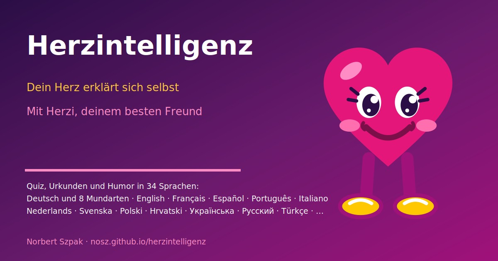

# Herzintelligenz: Dein Herz erklärt sich selbst

**Ein kleines Quiz-Lernspiel über dein Herz, erklärt von Herzi, deinem besten Freund.** Herzi ist ein kleines süßes Herz, das dich sehr lieb hat, dich duzt, Witze erzählt und dir in 8 kurzen Lektionen zeigt, wie das Herz arbeitet. Mit überraschenden Quizfragen, Urkunden zum Teilen und einer Frage, die nur Herzi stellen kann: *Wie oft hab ich für dich geschlagen?*

## [Jetzt starten: nosz.github.io/herzintelligenz](https://nosz.github.io/herzintelligenz/)

Kostenlos, ohne Anmeldung, läuft im Browser auf Handy, Tablet und Computer. Dein Fortschritt und dein Name bleiben nur auf deinem Gerät.

## Was dich erwartet
- **8 kleine Lektionen** mit Karten, Humor und einem Quiz: Aufbau, Kreislauf, Herzschlag, Herzstolpern, Herzen im Tierreich, Geschichte und eine Bossrunde.
- **Herzi**, das kleine pochende Herz, schaut vorbei, erzählt Herz-Fakten und Witze, tanzt und klettert durchs Bild.
- **Herzrechner:** Alter eintragen und erfahren, wie oft das Herz schon für dich geschlagen hat.
- **Urkunden** für jede Lektion und eine Meisterurkunde, zum Speichern, Drucken und Teilen.
- **33 Sprachen**, jeweils mit Flagge: Hochdeutsch, acht Mundarten und viele Weltsprachen. Der Link merkt sich die Sprache.
- **Installieren und offline nutzen:** auf dem Handy im Browsermenü „Zum Startbildschirm hinzufügen“, am Computer „App installieren“.

## Alle Sprachen mit Direktlink
Ein Klick startet die App gleich in der jeweiligen Sprache (Adresse mit `?lang=<Code>`); dieselben Links entstehen beim Teilen in der App.

**Deutsch und Mundarten**

| Flagge | Sprache | Direkt starten |
|---|---|---|
|  | Deutsch | [https://nosz.github.io/herzintelligenz/?lang=de](https://nosz.github.io/herzintelligenz/?lang=de) |
|  | Österreichisch | [https://nosz.github.io/herzintelligenz/?lang=at](https://nosz.github.io/herzintelligenz/?lang=at) |
|  | Schweizerisch | [https://nosz.github.io/herzintelligenz/?lang=ch](https://nosz.github.io/herzintelligenz/?lang=ch) |
|  | Schwäbisch | [https://nosz.github.io/herzintelligenz/?lang=swg](https://nosz.github.io/herzintelligenz/?lang=swg) |
|  | Bayrisch | [https://nosz.github.io/herzintelligenz/?lang=bay](https://nosz.github.io/herzintelligenz/?lang=bay) |
|  | Hessisch | [https://nosz.github.io/herzintelligenz/?lang=hes](https://nosz.github.io/herzintelligenz/?lang=hes) |
|  | Sächsisch | [https://nosz.github.io/herzintelligenz/?lang=sax](https://nosz.github.io/herzintelligenz/?lang=sax) |
|  | Plattdeutsch | [https://nosz.github.io/herzintelligenz/?lang=nds](https://nosz.github.io/herzintelligenz/?lang=nds) |
|  | Berlinerisch | [https://nosz.github.io/herzintelligenz/?lang=ber](https://nosz.github.io/herzintelligenz/?lang=ber) |

**Europa**

| Flagge | Sprache | Direkt starten |
|---|---|---|
|  | English (Englisch) | [https://nosz.github.io/herzintelligenz/?lang=en](https://nosz.github.io/herzintelligenz/?lang=en) |
|  | Français (Französisch) | [https://nosz.github.io/herzintelligenz/?lang=fr](https://nosz.github.io/herzintelligenz/?lang=fr) |
|  | Italiano (Italienisch) | [https://nosz.github.io/herzintelligenz/?lang=it](https://nosz.github.io/herzintelligenz/?lang=it) |
|  | Español (Spanisch) | [https://nosz.github.io/herzintelligenz/?lang=es](https://nosz.github.io/herzintelligenz/?lang=es) |
|  | Português (Portugiesisch (Portugal)) | [https://nosz.github.io/herzintelligenz/?lang=pt](https://nosz.github.io/herzintelligenz/?lang=pt) |
|  | Nederlands (Niederländisch) | [https://nosz.github.io/herzintelligenz/?lang=nl](https://nosz.github.io/herzintelligenz/?lang=nl) |
|  | Vlaams (Belgisch (Flämisch)) | [https://nosz.github.io/herzintelligenz/?lang=vls](https://nosz.github.io/herzintelligenz/?lang=vls) |
|  | Svenska (Schwedisch) | [https://nosz.github.io/herzintelligenz/?lang=sv](https://nosz.github.io/herzintelligenz/?lang=sv) |
|  | Norsk (Norwegisch) | [https://nosz.github.io/herzintelligenz/?lang=no](https://nosz.github.io/herzintelligenz/?lang=no) |
|  | Polski (Polnisch) | [https://nosz.github.io/herzintelligenz/?lang=pl](https://nosz.github.io/herzintelligenz/?lang=pl) |
|  | Čeština (Tschechisch) | [https://nosz.github.io/herzintelligenz/?lang=cs](https://nosz.github.io/herzintelligenz/?lang=cs) |
|  | Hrvatski (Kroatisch) | [https://nosz.github.io/herzintelligenz/?lang=hr](https://nosz.github.io/herzintelligenz/?lang=hr) |
|  | Magyar (Ungarisch) | [https://nosz.github.io/herzintelligenz/?lang=hu](https://nosz.github.io/herzintelligenz/?lang=hu) |
|  | Moldovenească (Moldawisch (Rumänisch)) | [https://nosz.github.io/herzintelligenz/?lang=mo](https://nosz.github.io/herzintelligenz/?lang=mo) |
|  | Українська (Ukrainisch) | [https://nosz.github.io/herzintelligenz/?lang=uk](https://nosz.github.io/herzintelligenz/?lang=uk) |
|  | Русский (Russisch) | [https://nosz.github.io/herzintelligenz/?lang=ru](https://nosz.github.io/herzintelligenz/?lang=ru) |
|  | Ελληνικά (Griechisch) | [https://nosz.github.io/herzintelligenz/?lang=el](https://nosz.github.io/herzintelligenz/?lang=el) |
|  | Türkçe (Türkisch) | [https://nosz.github.io/herzintelligenz/?lang=tr](https://nosz.github.io/herzintelligenz/?lang=tr) |

**Weltweit**

| Flagge | Sprache | Direkt starten |
|---|---|---|
|  | Español (Argentina) (Argentinisch (Spanisch)) | [https://nosz.github.io/herzintelligenz/?lang=esar](https://nosz.github.io/herzintelligenz/?lang=esar) |
|  | Português (Brasil) (Brasilianisch (Portugiesisch)) | [https://nosz.github.io/herzintelligenz/?lang=ptbr](https://nosz.github.io/herzintelligenz/?lang=ptbr) |
|  | 中文 (Chinesisch) | [https://nosz.github.io/herzintelligenz/?lang=zh](https://nosz.github.io/herzintelligenz/?lang=zh) |
|  | 日本語 (Japanisch) | [https://nosz.github.io/herzintelligenz/?lang=ja](https://nosz.github.io/herzintelligenz/?lang=ja) |
|  | Tiếng Việt (Vietnamesisch) | [https://nosz.github.io/herzintelligenz/?lang=vi](https://nosz.github.io/herzintelligenz/?lang=vi) |
|  | বাংলা (Bengalisch) | [https://nosz.github.io/herzintelligenz/?lang=bn](https://nosz.github.io/herzintelligenz/?lang=bn) |

## Gut zu wissen
- Die Fakten stammen aus dem Wikipedia-Artikel [Herz](https://de.wikipedia.org/wiki/Herz) (abgerufen 20.10.2026). Die App ersetzt keinen ärztlichen Rat. Herzi ist eine erfundene Figur, seine Witze sind erfunden.
- Die Mundarten und Fremdsprachen sind liebevoll gemeint; Muttersprachler dürfen gern korrigieren.
- Weitere Seiten von Norbert findest du in der App unter „Interessante Links“.

**Von Norbert Szpak** · [Impressum](https://nosz.github.io/energietankstelle/impressum.html) · Version 1.2.2 (20.10.2026) · Flaggen aus [flag-icons](https://github.com/lipis/flag-icons) (MIT-Lizenz)